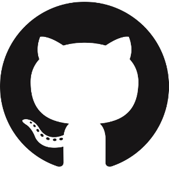

<!-- GitHub README -->

  
  &nbsp;&nbsp;&nbsp;
  

<h1 align="center">Илья Широбоких</h1>
<h3 align="center">Аналитик данных · Продуктовая аналитика · Machine Learning</h3>

У каждой цифры есть причина. Я ищу её.

  <a href="https://shiroko.tech">Портфолио</a> ·
  <a href="https://github.com/NoLupiPls">GitHub</a> ·
  <a href="https://t.me/NoLupiPls">Telegram</a>

---

Обо мне

Я аналитик данных с практическим опытом продуктовой аналитики в финтехе.

Использую SQL и Python для исследования пользовательского поведения, анализа продуктовых метрик, автоматизации отчётности и поиска закономерностей в данных.

Мне интересно разбираться в причинах изменений показателей, находить точки роста продукта и применять машинное обучение для решения прикладных аналитических задач.

Сейчас учусь на направлении «Экономика и бухгалтерский учёт», совмещая технические навыки с пониманием финансовых процессов и бизнес-показателей.

---

Опыт работы

Т-Банк — Продуктовый аналитик (стажёр)

Т-Инвестиции · Веб-терминал
Март 2026 — август 2026

Занимался продуктовой аналитикой инвестиционной платформы: исследовал пользовательское поведение, анализировал торговую активность и конверсию, автоматизировал регулярную отчётность.

Аналитика и эксперименты

* Анализировал воронку от открытия брокерского счёта и пополнения до первой сделки, выявляя точки потери пользователей.
* Исследовал пользовательское поведение с помощью SQL и Python, проводил когортный и сегментный анализ.
* Формировал и приоритизировал продуктовые гипотезы на основе поведенческих данных.
* Работал с методологией A/B-тестирования: определял целевые и защитные метрики, проверял сопоставимость групп и оценивал статистическую значимость.

Машинное обучение

* Строил модели градиентного бустинга для оценки вероятности совершения транзакции.
* Использовал SHAP для интерпретации предсказаний и определения поведенческих признаков, связанных с транзакционной активностью.

Автоматизация и результаты

* Сократил время подготовки регулярной отчётности с 4 часов до 30–40 минут — более чем в 6 раз — за счёт автоматизации расчётов на SQL и Python.
* Выявил точки потери пользователей на переходе от просмотра финансового инструмента к созданию заявки и сформировал требования для продуктовых улучшений.
* Систематизировал бэклог из 20+ гипотез, определив ожидаемый эффект, метрики проверки и приоритеты.
* Провёл более 10 аналитических исследований пользовательского поведения и торговых сценариев.

---

Ключевые проекты

Т-Поиск — финтех и принятие решений

Концепция финтех-продукта, который помогает пользователям принимать более обоснованные решения о покупках на основе финансовых данных.

Основные возможности

* Анализ расходов и доступного баланса.
* Помощь в выявлении импульсивных трат.
* Связь покупок с финансовыми целями и накоплениями.

Бизнес-модель и оценка

* Финансовое моделирование, включая расчёт маржинальности и срока окупаемости.
* Формирование продуктовых метрик и предположений об удержании пользователей.
* Концепция интеграции с экосистемой Т-Банка.

Расчётные показатели проекта

* Маржинальность: 37,25%.
* Ожидаемый срок окупаемости: 8 месяцев.
* Прогноз прибыли за первый год: 25 млн рублей.
* Целевое удержание пользователей: 34%.
* Прогнозируемый прирост новых пользователей в экосистеме Т-Город: 47,6%.

Показатели являются проектными оценками, а не подтверждёнными результатами действующего продукта.

Синопсис — HR-аналитика

Концепция аналитической платформы для прогнозирования риска увольнения сотрудников и поддержки проактивных HR-решений.

Основные возможности

* Прогнозирование риска увольнения с помощью машинного обучения.
* Поиск закономерностей, связанных с текучестью персонала.
* Формирование ранних сигналов для своевременного вмешательства HR-команд.

Аналитические задачи

* Построение моделей классификации и прогнозирования.
* Анализ признаков и оценка качества моделей.
* Интерпретация результатов и перевод прогнозов в практические бизнес-рекомендации.

Показатели качества моделей и бизнес-эффекта, приведённые в предыдущей версии описания проекта, требуют отдельного подтверждения и здесь не представлены как достигнутые результаты.

Квадро — аналитика рынка недвижимости

Концепция платформы, которая помогает пользователям пройти путь покупки квартиры — от изучения рынка до сопровождения сделки.

Основные возможности

* Исследование рынка недвижимости.
* Оценка стоимости объектов.
* Проверка юридических и транзакционных рисков.
* Анализ ипотечных сценариев.
* Поддержка принятия решений при покупке недвижимости.

Бизнес-модель

* Бесплатный доступ к поиску объектов и базовой оценке.
* Платные аналитические услуги для принятия важных решений.
* Потенциальные партнёрства с банками, агентствами недвижимости и юридическими компаниями.

Суть: пользователь платит за полезность конкретного решения, а не за весь процесс целиком.

ОкАвиа — технологии для путешествий

Концепция платформы, которая объединяет основные этапы путешествия: от покупки билетов до прибытия в пункт назначения.

Основные направления

* Планирование поездки.
* Оптимизация времени выезда в аэропорт.
* Навигация по аэропорту.
* Отслеживание рейсов в реальном времени.

---

Технические навыки

SQL и базы данных

* SQL
* PostgreSQL
* JOIN, агрегации и оконные функции
* Подготовка аналитических выборок и отчётных данных

Python и анализ данных

* Python
* pandas
* NumPy
* Jupyter Notebook
* Исследовательский анализ данных
* Обработка данных и автоматизация отчётности

Статистика и эксперименты

* Математическая статистика
* A/B-тестирование
* Проверка гипотез
* Когортный и сегментный анализ
* Анализ продуктовых воронок
* Интерпретация метрик

Машинное обучение

* scikit-learn
* Градиентный бустинг
* Классификация
* Оценка качества моделей
* Интерпретация моделей с помощью SHAP

Визуализация и разработка

* Matplotlib
* Power BI
* Git
* REST API
* Docker

---

Достижения

2026 — Буткемп Центрального университета

* Призовое место в составе команды.
* Презентация продуктового решения экспертному жюри.

2025 — Кейс-чемпионат Deadline

* Победа в кейс-чемпионате.
* Среди участников и партнёров — Т-Банк, Московская биржа, Авито и Центральный университет.

2024 — Кейс-чемпионат Deadline

* Призовое место.
* Среди участников и партнёров — Т-Банк, ВШМ СПбГУ, Центральный университет и Яндекс.

---

Образование

Президентская академия — Сибирский институт управления
Экономика и бухгалтерский учёт
Окончание обучения: 2028 год

Центральный университет
AI Track: Focus · 2026

Яндекс.Лицей
Основы промышленного программирования на Python · 2025

Код будущего
Основы промышленного программирования на Python · 2023

---

Профессиональные интересы

* Аналитика данных и продуктовая аналитика.
* Аналитические процессы на SQL.
* Эксперименты и статистический вывод.
* Машинное обучение для анализа поведения пользователей.
* Поиск закономерностей и формирование бизнес-рекомендаций на основе данных.

---

Контакты

Открыт к профессиональному общению и проектам на пересечении аналитики данных, финтеха и машинного обучения.

  
  

---

Каждая цифра имеет причину. Я ищу её.

  <a href="./README.md">English version</a>

